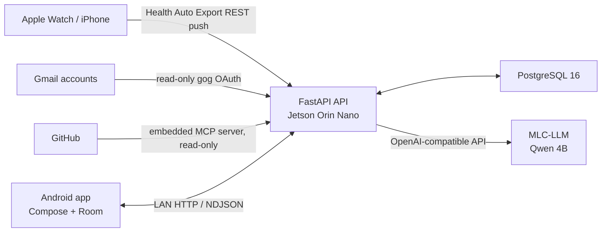

# LifeOS

LifeOS is a private, local-first personal intelligence system. It combines an
Android app with a FastAPI/PostgreSQL backend to turn health, mood, money,
important email, and GitHub activity into daily scores, patterns, and grounded
answers.

The production system runs on a Jetson Orin Nano and a Samsung Android phone.
Apple Health data comes from an iPhone/Apple Watch through Health Auto Export.
Core processing and primary storage stay on the Jetson; Gmail and GitHub are
read-only source integrations, and no cloud LLM is used.

## What it does

| Area | Current capability |
|---|---|
| **Money** | Money-first Android home with Overview, Transactions, and Cards; calendar-period spend, filters and sorting, categories, a home-screen spend widget, exact generated bills, and recorded spend in open card cycles |
| **Transactions** | Incremental read-only Gmail ingestion for bank/card/UPI alerts, deterministic and local-model parsing, account normalization, manual category overrides, audited repayment pairing, and audited merchant-refund adjustments with Undo |
| **Statements** | HDFC, Axis, ICICI, and SBI credit-card PDF summaries and details; due tracking and paid state; ordinary statement rows explain bills without entering spend; statement-only EMI/fee rows can fill gaps in live alerts |
| **Priority** | A focused multi-account Gmail workspace for direct actions, deadlines, interviews, appointments, travel, and security notices, with thread history, snooze/done state, feedback, and safe handoff to Gmail or the Android calendar |
| **Health** | Apple Health history and live Health Auto Export ingestion for sleep, vitals, activity, and workouts; sleep, recovery, fitness, wellness, consistency, and burnout analytics |
| **Pulse** | Daily mood, energy, focus, and stress check-in with an optional local reminder |
| **Execution** | GitHub commits, pull requests, and issues discovered by author and rolled into daily execution scores |
| **Insights** | Deterministic correlations plus grounded, best-effort local-model narratives and cross-domain synthesis |
| **Ask** | Streaming chat that routes general questions separately from personal questions and can use bounded health, execution, insight, and guarded money-query tools |

The Android app opens to **Money**. A left navigation drawer provides seven
destinations: Money, Priority, Today, Pulse, Insights, Ask, and Settings.

## Architecture



- **Android:** Kotlin, Jetpack Compose, Material 3, Hilt, Retrofit, Room,
  DataStore, and WorkManager. Room keeps the main screens useful between
  refreshes.
- **Backend:** FastAPI, SQLAlchemy, PostgreSQL 16, and Docker Compose.
- **Local model:** LifeOS Ask calls the MLC-LLM server directly at port `11434`.
  The legacy `OPENCLAW_*` configuration names remain, but the OpenClaw gateway
  on port `18789` is not part of the request path.
- **Time:** production day aggregation uses `Asia/Kolkata`. Audit timestamps are
  stored as real UTC instants.
- **Trust boundary:** the API is unauthenticated and intended for a trusted LAN.
  Do not expose port `8000` directly to the public internet.

## Data flows

### Apple Health

Health Connect ingestion has been removed from the Android app. Apple Health is
the single health source so activity is not counted once from Apple and again
from Samsung/Health Connect.

There are three supported paths:

1. **Live push:** Health Auto Export posts summarized daily metrics to
   `POST /health/auto-export`. This is the unattended source of truth.
2. **Historical backfill:** `backend/scripts/import_apple_health.py` streams a
   large Apple `export.zip` or `export.xml` into the idempotent
   `POST /health/batch` endpoint.
3. **Live Ask tool:** `phone_health_client.py` can query Health Auto Export's
   foreground TCP server for questions about the most recent readings.

For the Health Auto Export automation, use JSON, **Summarize Data = ON**, daily
grouping, **Since Last Sync**, and a frequent cadence while the iPhone is on the
home Wi-Fi. Include every metric LifeOS should own, including activity/workouts
if desired. Apple only lets the automation read HealthKit while the phone is
unlocked. The TCP server is optional, foreground-only, and benefits from a DHCP
reservation for the iPhone.

Example backfill commands:

```bash
# Parse only; no server writes
python backend/scripts/import_apple_health.py \
  --zip /path/to/export.zip --dry-run

# Import into a reachable LifeOS API
python backend/scripts/import_apple_health.py \
  --zip /path/to/export.zip --api-url http://192.168.3.30:8000
```

Imports and live pushes use different `source_id` prefixes. Do not overlap a
historical import window with a live-export window or the same night can be
counted twice.

### Money and credit cards

The backend reads Gmail through the `gog` CLI included in the API image. OAuth
tokens and the Google client secret remain in gog's encrypted file keyring; they
are not stored in Android, Postgres, the image, or `.env`. Android Settings owns
the normal **Money email** connection and reauthorization flow.

Live alerts are the source of normal purchases. Credit-card statement line items
are stored separately as explanatory detail and never enter Money spend. Only
EMI principal/interest/processing-fee rows that live alerts may miss can enter the
transaction table as `statement_emi`. Savings/current-account statement parsing
is intentionally disabled.

Money keeps three views separate:

- calendar-period spending;
- already-generated card bills; and
- recorded transactions in each currently open card cycle.

Current-cycle totals are not forecasts. They do not invent expected EMIs, fees,
subscriptions, or future bill totals.

See [Expenses API](backend/docs/expenses-api.md) for the full accounting contract.

### Priority mail

Priority uses a separate Gmail purpose and can use a different account from
Money. Structured invites and deterministic extraction run first; routine
newsletters, receipts, digests, and generic notices are suppressed. Ambiguous
local-model review is off by default so background mail polling does not compete
with Ask.

LifeOS never sends or modifies email. Calendar actions open Android's standard
calendar or the original invite, leaving the final save/accept action to the
user. See [Priority mail operations](backend/docs/priority-mail.md).

### Ask, scores, and insights

Daily scores and state classification are deterministic. Ask adds a bounded
local-model layer with citations and streams NDJSON events to Android. Personal
and general conversations are routed separately so old personal context does not
leak into unrelated questions.

Money questions use an allowlisted semantic query contract. The model never
supplies executable SQL, table names, columns, or functions; SQLAlchemy builds
the only database query. Common factual questions are prefetched
deterministically so correctness does not depend on the model choosing a tool.

## Quick start

### Prerequisites

- Docker and Docker Compose on the backend host (production uses a Jetson Orin
  Nano).
- An OpenAI-compatible local model endpoint if Ask and LLM-assisted parsing are
  required. Production uses MLC-LLM on `:11434`.
- Android Studio, JDK 17, and Android SDK 35 for the app.
- The Android device and backend on the same trusted network.
- Optional source accounts: Apple Health Auto Export Premium, read-only Gmail,
  and a read-only GitHub token.

### Backend

```bash
git clone git@github.com:ajmalrasi/life_os.git
cd life_os/backend
cp .env.example .env
# Edit .env for this host. Never commit it.
docker compose up -d --build

curl http://localhost:8000/healthz
curl http://localhost:8000/docs
```

Docker Compose starts PostgreSQL and the API. MLC-LLM is a separate host service
in the production deployment.

Important settings:

| Setting | Purpose |
|---|---|
| `POSTGRES_USER`, `POSTGRES_PASSWORD`, `POSTGRES_DB` | Database credentials used by Compose |
| `OPENCLAW_BASE_URL`, `OPENCLAW_MODEL` | OpenAI-compatible local model endpoint and model name |
| `OPENCLAW_TIMEOUT_SECONDS`, `OPENCLAW_CHAT_DEADLINE_SECONDS`, `OPENCLAW_MAX_TOKENS` | Ask latency and generation bounds; keep the Android 150-second read timeout in mind |
| `GITHUB_TOKEN`, `GITHUB_USER` | Read-only execution discovery by author; `GITHUB_REPOS` is retained only for chat/backward compatibility |
| `HAE_HOST`, `HAE_PORT` | Optional foreground live-health TCP server on the iPhone |
| `GOGCLI_DATA_DIR`, `GOG_KEYRING_PASSWORD` | Persistent encrypted gog OAuth/keyring storage |
| `CC_OWNER_NAME`, `CC_OWNER_DOB`, `CC_PDF_PASSWORD_OVERRIDES` | Credit-card PDF unlock inputs |
| `EXPENSE_OWNER_IDENTITIES` | Names/UPI handles used to exclude self-transfers |
| `PRIORITY_BACKFILL_DAYS`, `PRIORITY_LLM_ENABLED` | Priority history window and optional ambiguous-item model review |

The deployed Jetson checkout lives at `/home/ajmalrasi/life_os`. A normal update
is:

```bash
ssh -i ~/.ssh/jetson_key ajmalrasi@192.168.3.30
cd /home/ajmalrasi/life_os
git pull
cd backend
docker compose up -d --build api
curl -fsS http://localhost:8000/healthz
```

`backend/.env` contains production secrets and must never be overwritten during
a deploy.

### Android

1. Open `android/` in Android Studio.
2. Build/install the debug app on the device or emulator.
3. In **Settings**, set the LifeOS server address. Production uses
   `http://192.168.3.30:8000/`; an emulator can use
   `http://10.0.2.2:8000/` for a backend running on the development machine.
4. Connect the Money and/or Priority Gmail accounts if those features are
   wanted.
5. Use **Sync everything** in Settings for an explicit Gmail, statement,
   Priority, score, execution, and insight refresh.

Opening the app refreshes Android's caches without polling Gmail or invoking the
local model. The nightly worker recomputes analytics, and the spend widget has a
separate six-hour best-effort refresh. Pulse reminders are opt-in and request the
Android notification permission when enabled.

The repository currently has no usable Gradle wrapper JAR, so Android Studio is
the supported build path. A debug APK is written to
`android/app/build/outputs/apk/debug/`.

## API overview

The authoritative machine-readable API is at `GET /openapi.json`; interactive
documentation is at `GET /docs`.

| Area | Representative endpoints |
|---|---|
| Health | `POST /health/auto-export`, `POST /health/batch` |
| Pulse | `POST /mood`, `GET /mood` |
| Analytics | `POST /analytics/recompute`, `GET /analytics/scores`, `GET /analytics/state`, `GET /analytics/insights`, `GET /analytics/synthesis` |
| Execution | `POST /collectors/execution/sync`, `GET /github`, `POST /github` |
| Money | `GET /expenses`, `POST /expenses/sync`, repayment/refund/category routes, `GET /payee-labels` |
| Cards | `GET /statements`, `POST /statements/sync`, statement details/paid routes, `GET /statements/cycles/current` |
| Priority | `GET /priority`, `GET /priority/{id}`, `PATCH /priority/{id}`, `POST /priority/sync/check`, feedback routes |
| Gmail accounts | `GET /mail/accounts`, OAuth connect/complete and purpose-disconnect routes |
| Ask | `POST /chat/stream`, `POST /chat`, `GET /chat/suggestions`, `GET /chat/health` |

## Development and verification

### Backend tests

```bash
cd backend
pytest -q
```

Tests use SQLite and do not require PostgreSQL, Gmail, GitHub, or the local model.

### Android tests

Run unit tests and `assembleDebug` from Android Studio. Connected Compose tests
live under `android/app/src/androidTest/` and should be run on a device/emulator
for navigation or Money UI changes.

### Database changes

LifeOS still uses SQLAlchemy `create_all()` at startup and has no Alembic
migration framework. It creates missing tables but does **not** alter existing
columns. Any schema change to a deployed database therefore needs an explicit,
idempotent SQL migration applied before the rebuilt API starts. Existing scripts
live under `backend/scripts/`.

## Repository layout

```text
life_os/
├── backend/
│   ├── app/
│   │   ├── api/routes/          FastAPI routes
│   │   ├── mail/                Gmail provider and OAuth/keyring integration
│   │   ├── models/              SQLAlchemy models
│   │   ├── priority/            Priority classification and notifications
│   │   ├── repositories/        Database access
│   │   ├── schemas/             API request/response models
│   │   └── services/            Analytics, health, money, GitHub, statements, Ask
│   ├── docs/                    Expenses and Priority operational references
│   ├── ops/systemd/             MLC watchdog and Priority sync units
│   ├── scripts/                 Imports, migrations, maintenance, watchdog
│   ├── tests/                   Backend test suite
│   ├── Dockerfile
│   └── docker-compose.yml
├── android/
│   └── app/src/
│       ├── main/java/com/lifeos/app/
│       │   ├── data/            Retrofit, Room, and repositories
│       │   ├── domain/          Models and repository contracts
│       │   ├── presentation/    Money, Priority, Today, Pulse, Insights, Ask, Settings
│       │   ├── sync/            Unified app refresh/sync coordinator
│       │   ├── widget/          Spend widget
│       │   └── work/            Nightly, reminder, and widget workers
│       ├── test/                JVM unit tests
│       └── androidTest/         Connected Compose tests
├── AGENTS.md                    Detailed operational history and agent handoff notes
└── README.md
```

## Operational notes and limitations

- The production API/database run on the Jetson; backend changes are verified
  there after deployment. Android changes need a build and device/emulator check.
- `/chat/health` proves that the model endpoint answers `/v1/models`; it does not
  prove that a full generation will complete. The supplied MLC watchdog also
  performs a real token-generation probe and can recover a stuck decoder.
- `POST /analytics/recompute` keeps health scoring synchronous but runs GitHub
  execution discovery in the background to keep user-visible sync fast.
- Gmail OAuth must use a Google Cloud consent screen in **Production** mode;
  Testing-mode refresh tokens expire after seven days. Only `gmail.readonly` is
  required.
- Firebase push is optional and remains inactive unless the optional backend
  dependency, credentials, and Android Google Services configuration are
  supplied. Local Pulse reminders do not require Firebase.
- Location intelligence and device-activity/screen-time ingestion are not yet
  implemented.

## License

Personal project. Core LifeOS data and model inference stay on the Jetson and
Android device.
