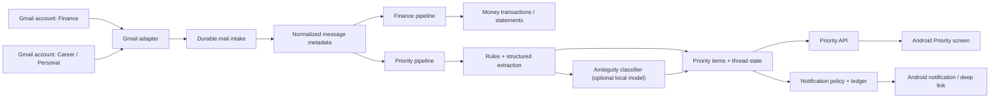

# LifeOS Priority Mail — Product and Architecture Design

Status: implemented in the backend and Android app; the second account still
requires one-time read-only OAuth authorization and registration on the Jetson.

## 1. Product decision

The durable feature is **Priority**, not an interview-specific inbox. It is a
LifeOS view of messages that deserve attention across explicitly connected mail
accounts. Interviews are one automatic label and one filter alongside Personal,
Work, Appointment, Deadline, Security, Travel, and Document.

LifeOS does not become an email client. Gmail remains the source of truth. The
Priority surface provides classification, extracted actions and dates, tracking,
and a reliable link to the exact original message in the correct account.

## 2. Design principles

1. **Accounts are first-class.** Finance and Priority never share a hard-coded
   mailbox setting or accidentally invoke each other's parsers.
2. **One generic mail foundation, independent consumers.** Gmail transport,
   account identity, durable fetch state, and normalized messages are shared.
   Finance and Priority are separate pipelines built on that foundation.
3. **Fetch and classification are separate.** Once a Gmail message id is
   durably recorded, the sync cursor may advance. Content extraction or a local
   model failure cannot cause an email to be lost.
4. **The local model is optional, not the gatekeeper.** Structured calendar data,
   headers, deterministic rules, and explicit action/date extraction run first.
   The model helps only with ambiguous semantic classification. Failure places
   an item in Review and schedules a retry.
5. **No silent discard of uncertainty.** Important/high-confidence messages are
   surfaced; ambiguous candidates enter Review; only strong bulk/noise signals
   suppress a message.
6. **Minimal retention.** Full email bodies are read transiently for processing.
   LifeOS persists the original identifiers, metadata, a short verification
   preview, extracted fields, and classification evidence—not a second mailbox.
7. **User corrections are authoritative and auditable.** Labels, importance,
   dates, and status can be corrected without modifying Gmail. Automatic
   reprocessing cannot overwrite a manual decision.

## 3. User experience

### Priority feed

The main screen is ordered by attention, not by raw arrival time:

- **Needs attention** — replies, scheduling choices, signatures, documents, and
  approaching deadlines.
- **Upcoming** — confirmed interviews, appointments, meetings, travel, or other
  dated events.
- **Recently important** — useful personal/work messages with no required action.
- **Review** — plausible important messages that LifeOS cannot classify safely.

Filter chips: All, Needs action, Scheduled, Personal, Work, Interview, Security,
and Review. Labels are multi-valued: an item may be both `work` and `interview`,
or `personal` and `appointment`.

Each feed item shows:

- category and state;
- sender/company and original subject;
- one- or two-line factual summary;
- extracted action, deadline, or event time;
- source account badge;
- unread/new indicator;
- direct access to the original Gmail message.

For a scheduled interview or appointment, the detail view also provides a
contextual calendar action. It is never shown for ordinary messages.

### Detail view

Tapping an item opens a native LifeOS detail sheet/screen with:

- **Why this matters**, backed by the signals used to classify it;
- extracted people, company, role, action, deadline, event time, duration,
  location, and meeting/scheduling links;
- a short source preview for verification;
- thread history, including reschedules and cancellations;
- Open original, Mark done, Snooze, Change labels, Correct details, and Not
  important actions.

The original message opens using its Gmail account identity plus thread/message
id. LifeOS must never rely on the user's current Gmail account index.

### Calendar actions

The calendar action depends on the source message:

- **Add to calendar** — a plain email contains a complete date and time but no
  structured calendar invitation.
- **Open calendar invite** — the email already contains an ICS/calendar invite;
  the calendar app owns acceptance and duplicate handling.
- **Choose a time** — an interview invitation requires scheduling and has no
  confirmed event yet. After confirmation arrives, the thread changes to the
  appropriate calendar action.

For Add to calendar, Android launches the platform's standard calendar-insert
screen with title, start/end, timezone, company/person, location, meeting link,
and original Gmail link pre-filled. The user chooses the destination calendar
and explicitly saves it. LifeOS does not request broad calendar permissions,
silently write events, or assume that the interview Gmail account is also the
desired calendar account.

This is intentionally an Android calendar intent rather than a new Calendar
OAuth integration. It works with Google Calendar, Samsung Calendar, Outlook, or
another installed provider and keeps the final external write under user
control. A future direct Calendar connection can be added as a separate provider
without changing Priority's extracted-event model.

### Notifications

- Immediate: high-confidence urgent personal message, interview/schedule change,
  security action, or near deadline.
- Reminder: actionable item remains open near its deadline or event.
- Quiet: ordinary important mail appears only in Priority or a daily digest.
- Every push contains a Priority item id and opens its detail screen.
- A notification ledger prevents duplicate pushes after retries or reprocessing.

## 4. Target architecture



### Module boundaries

The former `GmailClient` transport accepted an account per instance but exposed
its generic message type through `expense_parsers`. The implementation moves
both into the provider-neutral `app.mail` package before adding Priority.

Proposed backend packages:

```text
app/mail/
  models.py             # MailMessage, MailAccountRef, attachment metadata
  provider.py           # MailProvider protocol
  gmail_provider.py     # gog-backed read-only Gmail implementation
  intake.py             # incremental fetch, durable cursor, retry state
  accounts.py           # account lookup and purpose assignment

app/priority/
  models.py             # PriorityItem, source-message link, feedback, notification ledger
  classifier.py         # deterministic labels, importance, direct-human signals
  extractor.py          # dates, actions, links, people, company, role, location
  calendar.py           # ICS/calendar parsing and reschedule/cancellation handling
  ambiguity.py          # optional structured local-model classifier
  service.py            # orchestration and thread-level state transitions
  repository.py

app/api/routes/priority.py
app/schemas/priority.py
```

Finance parsers import `MailMessage` from `app.mail.models`; they do not depend
on Priority. Priority does not import transaction, statement, or Money code.

On Android:

```text
domain/model/PriorityModels.kt
domain/repository/PriorityRepository.kt
data/remote/dto/PriorityDtos.kt
data/repository/PriorityRepositoryImpl.kt
presentation/priority/PriorityViewModel.kt
presentation/priority/PriorityScreen.kt
presentation/priority/PriorityDetailsScreen.kt
calendar/PriorityCalendarLauncher.kt  # maps extracted events to the system insert intent
```

`Destination.PRIORITY` is a first-class navigation destination with its own deep
link. It is not a conditional section inside Money or Insights.

## 5. Account model

Do not add `JOB_GMAIL_ACCOUNT` or a comma-separated list of addresses. Introduce
a real account registry:

### `mail_accounts`

- `id`
- `provider` (`gmail` initially)
- `provider_account_id` (normalized email address)
- `display_label` (for example, Career inbox)
- `enabled`
- `created_at`, `updated_at`
- unique `(provider, provider_account_id)`

### `mail_account_purposes`

- `mail_account_id`
- `purpose` (`finance`, `priority`)
- `enabled`
- unique `(mail_account_id, purpose)`

OAuth credentials remain in gog's protected credential store. The database
stores only the provider account identity and purpose assignment. Both Gmail
accounts are authorized independently with read-only Gmail scope.

Settings can initiate gog's two-step remote flow. The Jetson creates the Google
authorization URL and retains the S256 PKCE verifier. Android opens the URL and
temporarily listens on `127.0.0.1` for Google's loopback callback, then sends the
one-time callback URL plus a separate short-lived pairing secret to the Jetson.
The Jetson validates the exact callback origin and OAuth state, exchanges the
code, and stores the refresh token in its encrypted gog keyring. The refresh
token never crosses the LifeOS API boundary.

The current `GMAIL_ACCOUNT` environment value is migrated once into an account
with the `finance` purpose. It remains as a temporary bootstrap fallback for one
release, then is removed after production verification. Priority onboarding
registers the second authorized account with only the `priority` purpose.

## 6. Durable intake and failure handling

Each `(account, consumer)` has independent state:

- last successful Gmail cursor;
- last attempt and last success timestamps;
- current authorization/transport status;
- count of messages pending content fetch or classification;
- last visible error.

Intake flow:

1. List new non-spam/non-trash messages after the account cursor.
2. Persist each Gmail message id, thread id, labels, sender, recipients, subject,
   internal date, and processing state.
3. Commit the durable intake batch.
4. Advance only that account's intake cursor.
5. Fetch body/structured calendar content for pending messages.
6. Run the enabled consumer pipelines idempotently.
7. Discard full body content after extraction unless a bounded retry requires it.

This avoids the existing financial collector's coupling between fetching and
parsing. A network/model/parser failure retries pending work without re-reading
the entire mailbox or losing later mail.

## 7. Classification contract

Priority classification produces structured, explainable output:

- `importance`: high, normal, review, suppressed;
- `labels`: zero or more controlled labels;
- `state`: needs_action, scheduled, informational, done, snoozed, cancelled;
- `confidence`: 0–1;
- `summary` and `why_important`;
- `action_text`, `action_url`, `due_at`;
- `event_start`, `event_end`, `timezone`, `location`, `meeting_url`;
- `calendar_uid` and structured-invite presence when supplied by ICS;
- extracted people/company/role;
- evidence codes explaining the decision.

Classification order:

1. Structured Gmail/calendar metadata and ICS fields.
2. Strong deterministic signals: direct recipient, human sender, reply thread,
   explicit request, deadline, confirmation, reschedule, or cancellation.
3. Strong noise signals: list/bulk headers, unsubscribe metadata, job digest,
   promotions, generic application receipt, or marketing template.
4. Deterministic entity/action/date extraction.
5. Optional local-model classification only when rules are inconclusive.

The model returns a validated allowlisted schema. It cannot invent labels,
execute actions, access other mailboxes, or decide whether intake progress is
committed. Invalid output becomes Review, never “not important.”

## 8. Thread semantics

The unit shown to the user is a Priority thread, not every source message.

- A confirmation updates a scheduling request.
- A reschedule replaces the active event time while preserving the old value in
  history.
- A cancellation changes the active state and cancels future reminders.
- A reply or follow-up can reopen a completed item when it asks for new action.
- New source messages remain linked for audit and exact Gmail navigation.

Manual state and labels take precedence over automatic recomputation. Automatic
fields and user overrides are stored separately rather than overwriting each
other.

## 9. API surface

- `GET /priority` — filtered/paginated feed, ordered by urgency.
- `GET /priority/{id}` — detail, extracted fields, evidence, and thread history.
- `PATCH /priority/{id}` — done/snoozed state and user overrides.
- `POST /priority/{id}/feedback` — important/not-important and label/date corrections.
- `POST /priority/sync` — explicit check-now for enabled Priority accounts.
- `GET /mail/accounts` — connection status and purpose assignments; never tokens.

The hourly source poll runs on the Jetson, not primarily through Android
WorkManager. This keeps ingestion running while the phone is asleep or away from
the home network. Android refreshes the feed on app open and after a push.

## 10. Storage outline

- `mail_accounts`
- `mail_account_purposes`
- `mail_messages` (durable minimal intake metadata and processing state)
- `priority_items` (thread-level current automatic state)
- `priority_item_messages` (source/audit relationship)
- `priority_overrides` (authoritative user corrections)
- `priority_notifications` (deduplication and delivery state)

All Gmail identifiers use a composite account scope. A Gmail message id alone
is never treated as globally unique.

## 11. Delivery sequence

### Phase A — foundation refactor

1. Move the generic mail data type out of `expense_parsers`.
2. Introduce the provider protocol and gog Gmail adapter.
3. Add account/purpose registry and durable intake state.
4. Adapt Finance to the generic intake without changing transaction behavior.
5. Prove all existing expense/statement tests and production sync still pass.

### Phase B — Priority backend

1. Add Priority tables, repository, classifier, extractor, and APIs.
2. Add thread updates, Review fallback, overrides, and notification ledger.
3. Authorize/register the second read-only Gmail account.
4. Run a dry backfill report before surfacing or notifying anything.

### Phase C — Android experience

1. Add the Priority destination, feed, filters, and details.
2. Add exact-account Gmail opening and notification deep links.
3. Add contextual Choose time, Add to calendar, and Open calendar invite actions.
4. Add feedback, snooze, mark-done, and error/connection states.
5. Verify the design with real data before enabling immediate notifications.

## 12. Verification gates

Backend tests must cover:

- strict separation between finance and Priority accounts;
- idempotent intake and classification;
- cursor safety across Gmail, parser, and model failures;
- calendar confirmation, reschedule, and cancellation sequences;
- direct-human vs newsletter/job-digest behavior;
- account-scoped Gmail/thread identifiers;
- manual overrides surviving reclassification;
- notification deduplication;
- expired OAuth reported for the correct account without affecting the other.

Android tests must cover:

- feed grouping/filtering and urgency ordering;
- empty, loading, Review, stale-sync, and account-error states;
- correct account/message used by Open original;
- notification deep link to the intended item;
- calendar actions appearing only when their structured prerequisites exist;
- pre-filled calendar intent preserving the extracted instant, timezone,
  duration, location, meeting link, and source-message link;
- mark-done/snooze/feedback persistence after refresh.

Production rollout is complete only after the existing Money Gmail sync, the new
Priority sync, exact-message Gmail navigation, and a real reschedule/cancellation
thread are verified independently.
